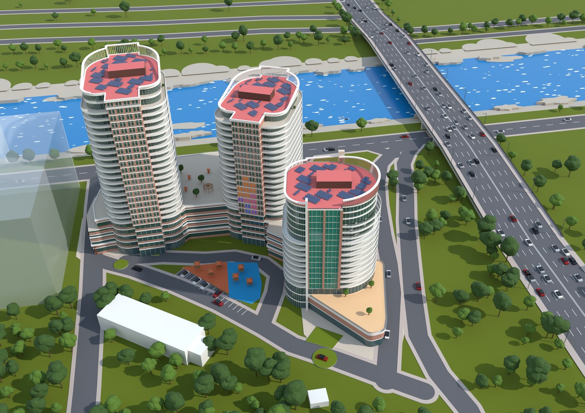
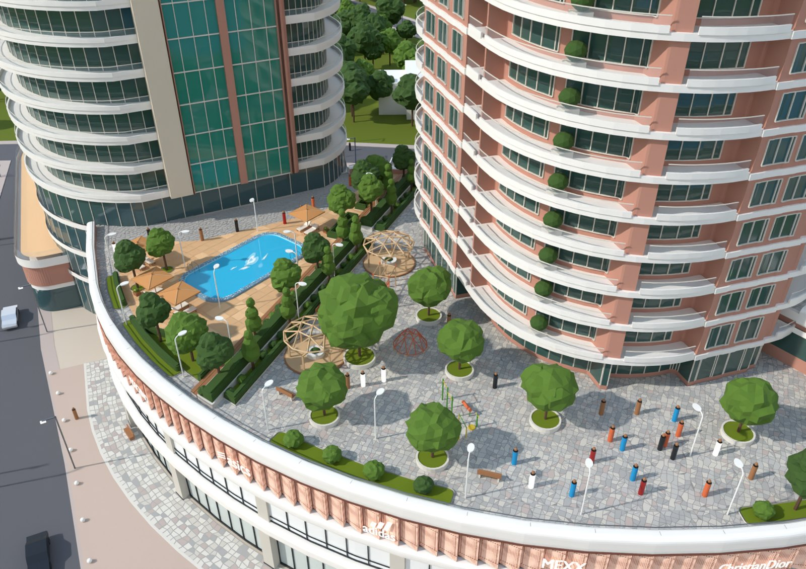

# Skyline Residence – 3D building demo

Interactive 3D model of the Shahrofar riverside complex (three towers on a curved retail podium) for real-estate sales: pick a tower and a floor, open an apartment card with its floor plan and price, then walk around inside it.





Built with [Three.js](https://threejs.org) and [Vite](https://vitejs.dev).

## Where things come from

| | Source |
|---|---|
| Apartments, rooms, walls, windows, balconies of blocks В and Б | the architect's floor plans: typical floor (sheet 7), floors 23–24 (sheet 8) |
| Floor levels | section 1-1 (sheet 13): floor 5 at +18.6, then 3.3 m per floor; roofs at +84.9 (В) and +71.7 (Б) |
| Look, site, podium, hotel, surroundings | the aerial marketing render (its camera was recovered from its vanishing points) |
| Podium roof deck, shop front, promenade | the deck marketing render: pool area, planted strip, playground with lattice pergolas, perforated copper band (`blender/complex/deck/`, `facade.py`, `street.py`) |
| Prices and sold/reserved statuses | demo values in `src/data.js` |

| | Floors | Apartments |
|---|---|---|
| Block В | 24 | floors 5–24, 8 per floor (1–3 rooms, 41–174 m²), terraces on 23–24 |
| Block Б | 20 | floors 5–20, 8 per floor (1–3 rooms, 52–154 m²) |
| Block А | 16 | hotel, not for sale |

## Interiors

The walk-through is fitted out in the browser from the floor plans (`src/floor.js`, models and materials in `src/interior/`):

- each room's outline is probed from inside to find what is behind it (wall, window, glazing or an opening); door-wide gaps between rooms get a door frame, the wall over the door and an open leaf (only where it leaves room to walk round it and does not swing into the way to another doorway)
- skirting along the walls, tiled walls and floors in bathrooms and WCs, window frames, sills, radiators, sheer curtains in living rooms and bedrooms
- bathroom fittings where the drawing has them (WC, basin, bath, laundry counter); furniture against solid walls, away from doors and windows, with space kept to walk in front of beds, wardrobes and the kitchen; collisions with furniture
- light: a small studio environment indoors instead of the sky, warm bounce light, the sun's shadows pulled in round the flat, ceiling pendants and downlights with shadows (high level)
- textures (oak floor, porcelain, plaster, fabrics, veneers, rugs, paintings) are drawn on canvases at load, no image files

`node tools/interior_shots.mjs build/interior --apt V12-7,B8-1` takes a picture from a corner of each room of the given flats.

## Playground and surroundings

- The ground-level playground by the car park is fitted out in the viewer (`src/playground.js`) on the model's rubber surfaces: two play towers with a rope bridge, slides, a climbing wall and a fireman's pole, swings with a nest swing, a roundabout and painted games for older children; a sandpit under a shade sail, a play house, spring riders and a see-saw for small ones; a fence with gates, benches, bins and a sign.
- The crazy paving of the decks, the hotel terrace and the promenade uses four close tones of one stone; the neighbours' plain massing gets storeys and windows drawn on in the shader.
- `node tools/shots.mjs build/shots --only playground,playground_eye,cars` for close views.

## Rebuilding the model

```bash
pip install bpy shapely pymupdf      # Blender as a Python module (Python 3.13); or have a Blender 4.2+ binary on PATH
blender/plans/make_plans.sh SET.pdf  # only when the drawings change: PDF -> blender/plans/plans.json
blender/export_web.sh                # -> public/models/shahrofar.glb, src/model/complex.json, src/model/plans.json
RENDER=1 blender/export_web.sh       # also renders build/shahrofar.png from the marketing render's camera
```

- `blender/plans/extract_pdf.py` pulls the vector paths and labels of one tower out of a plan sheet; `build_plans.py` turns them into walls, windows, apartments and rooms (names and areas as written on the sheet, e.g. "Хонаи хоб 15.17" → Bedroom 15.17 m²).
- `blender/build_complex.py` builds the scene; it also takes `--view "river aerial" | "avenue street" | "river street"` for other stills.
- `blender/shahrofar.blend` is a ready-made copy of the scene to open in Blender.

## Run locally

```bash
npm install
npm run dev
```

Then open http://localhost:5173.

## Publish

Every push to `main` is built and published to GitHub Pages by `.github/workflows/deploy.yml` (turn Pages on in the repository settings: Source → GitHub Actions).

## Controls

- **Complex:** drag to rotate, scroll to zoom, hover a tower to see its floors, click a floor (or pick one from the list; switch towers with the Block V / Block B tabs), then click an apartment.
- **Inside:** drag to look around, click the floor to walk there, or use WASD / arrow keys. On touch screens, use the on-screen joystick.
